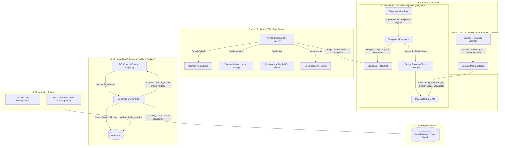

# Product Requirements Document (PRD) & Technical Architecture Specification

**Project Name:** `Godly.Design`  
**Vision:** An elite visual inspiration platform and component registry combining the core strengths of:
1. **Mobbin & Details.so:** Full company profiles, complete landing page recordings, page-by-page walkthroughs, and section-by-section video clips.
2. **Posts.design:** Curated marketing assets (OpenGraph images, social media announcement graphics, launch videos, email designs, and hero headers).
3. **21st.dev + MCP:** A paywalled, monetized Model Context Protocol (MCP) server delivering design tokens, visual keyframes, and code directly into Cursor, Claude Desktop, Antigravity, and Windsurf.

---

## 1. Executive Summary & Information Architecture

The platform is organized into a clean 3-pillar content model:

```
                                  [ COMPANY / BRAND ]
                             (e.g., Linear, Raycast, Supabase)
                                      │
            ┌─────────────────────────┼─────────────────────────┐
            ▼                         ▼                         ▼
    [ PRODUCT PAGES ]         [ MARKETING ASSETS ]      [ CODED COMPONENTS ]
    (Full-Page & Sections)     (Posts.design Style)      (21st.dev / MCP Style)
    • Full landing page video  • OG images               • Opaque ID (#cmp_123)
    • Subpages (Pricing, etc.) • Social media posts      • Paywalled registry URL
    • Isolated section clips   • Product launch videos   • TypeScript source code
      (Hero, Bento, Footer)    • Header / banner art     • Keyframe sprites for AI
```

1. **Public Showcase (Zero-Code Leak):** Visitors explore high-res looping videos of full pages, section clips, and marketing art. **No source code, underlying package registry URLs, or AI style prompts are exposed on the public site.**
2. **The "Copy Prompt" Workflow:** Users copy an opaque prompt containing an ID (`Use @godly to build #sec_pricing_42...` or `Use @godly to match design system #brand_linear`).
3. **Monetized MCP Engine:** The MCP server validates the developer's API key and daily quota via Cloudflare KV before unlocking code, design tokens, and multi-frame visual context.

---

## 2. High-Level System Architecture



---

## 3. Technology Stack & Infrastructure

| Layer | Technology | Rationale |
| :--- | :--- | :--- |
| **Frontend Framework** | **Astro 5 + Blume Foundation** | 100/100 Core Web Vitals, native Cloudflare Pages deployment, zero-JS baseline, automated Schema.org (`VideoObject`, `ImageGallery`), and `llms.txt`. |
| **Frontend UI** | **Tailwind CSS + React Islands** | Selective hydration (`client:visible`) for video hover autoplay on heavy masonry grids. |
| **CMS & Admin** | **PayloadCMS 3.0** | Relational admin dashboard to organize Companies -> Pages -> Sections -> Marketing Assets. Hosted on Railway/Render ($5/mo). |
| **Primary Database** | **MongoDB Atlas** | **Zero SQL migrations.** Seamlessly handles deep document nesting and relational references. Atlas `$vectorSearch` powers semantic MCP queries. |
| **Media & CDN** | **Cloudflare R2 + CDN (`cdn.yoursite.com`)** | **$0 egress fees** on high-bandwidth looping video clips, OG images, and keyframe WebPs. Canonical clean folder taxonomy. |
| **MCP Server** | **Cloudflare Workers** | `@modelcontextprotocol/sdk` running on global edge. Fast cold starts (<5ms), 10M requests for $5/mo. |
| **Rate Limiter / Cache** | **Cloudflare KV** | Sub-millisecond API key validation and daily quota tracking at the edge. |
| **Multimodal Ingestion** | **Gemini 3.8 Flash** | Ultra-fast vision model to batch-process 6 keyframes and extract structured JSON design tokens. |
| **Scraper** | **Playwright + FFmpeg (Node.js)** | Full-page scroll recording, section cropping, OG image extraction, and video compression. |
| **Auth & Billing** | **Clerk + Dodo Payments** | Clerk for developer login and API key generation; Dodo Payments as Merchant of Record for global subscriptions. |

---

## 4. Cloudflare R2 Storage Architecture & URL Taxonomy

All media is served through a branded custom domain (e.g., `https://cdn.godly.design`) connected to the R2 bucket via Cloudflare's global edge network.

### A. Canonical Bucket Hierarchy
Assets are stored under human-readable, deterministic paths matching your database taxonomy rather than random UUID blobs:

```
r2-bucket/
├── brands/
│   └── {company_slug}/                               # e.g., "linear"
│       ├── logo.webp                                 # Brand logo
│       ├── icon.webp                                 # Favicon / app icon
│       └── pages/
│           └── {page_slug}/                          # e.g., "landing-2026", "pricing"
│               ├── full-walkthrough.webm             # Complete scroll recording (720p/1080p)
│               └── poster.webp                       # Full-page cover stitch
│
├── sections/
│   └── {company_slug}/
│       └── {section_custom_id}/                      # e.g., "sec_lin_hero_01"
│           ├── preview.webm                          # 5-8s looping video clip (< 1.5MB)
│           ├── poster.webp                           # First-frame poster image
│           └── keyframes/                            # Sliced for LLM Vision MCP
│               ├── frame-1.webp
│               ├── frame-2.webp
│               ├── frame-3.webp
│               ├── frame-4.webp
│               ├── frame-5.webp
│               └── frame-6.webp
│
├── marketing/
│   └── {company_slug}/
│       ├── og-images/
│       │   └── {year}/{asset_slug}.webp              # OpenGraph meta images
│       ├── social/
│       │   └── {year}/{asset_slug}.webp              # Twitter/X feature announcement graphics
│       ├── launch-videos/
│       │   └── {year}/{asset_slug}.mp4               # Product demo teaser clips
│       └── headers/
│           └── {asset_slug}.webp                     # Newsletter / hero banner art
│
└── components/                                       # Standalone Coded UI Registry
    └── {component_custom_id}/                        # e.g., "cmp_nav_94"
        ├── preview.webm                              # 3-5s interaction video loop (< 800KB)
        └── poster.webp                               # Clean first-frame thumbnail image
```

### B. Clean Public URL Examples
| Asset Type | Production CDN URL |
| :--- | :--- |
| **Brand Logo** | `https://cdn.godly.design/brands/linear/logo.webp` |
| **Landing Video** | `https://cdn.godly.design/brands/linear/pages/landing-2026/full-walkthrough.webm` |
| **Section Loop** | `https://cdn.godly.design/sections/linear/sec_lin_hero_01/preview.webm` |
| **Section Keyframe (AI)** | `https://cdn.godly.design/sections/linear/sec_lin_hero_01/keyframes/frame-3.webp` |
| **OG Image** | `https://cdn.godly.design/marketing/linear/og-images/2026/linear-asks.webp` |
| **Component Loop** | `https://cdn.godly.design/components/cmp_nav_94/preview.webm` |

### C. Edge Caching & Compression Standards
1. **Video Encoding Standards (FFmpeg):**
   - Format: WebM (VP9 / Opus) for public web loops (average size: 400KB – 1.2MB).
   - Fallback: MP4 (H.264 / AAC) for Safari legacy compatibility.
   - Profile: Muted, loop-optimized, CRF 28, max-height: 720p (preserves UI crispness without bandwidth waste).
2. **Image Encoding Standards:**
   - Format: WebP (quality: 85% for screenshots, lossless for UI icons and logos).
3. **HTTP Cache Headers (Enforced by Cloudflare CDN Rules):**
   - `Cache-Control: public, max-age=31536000, immutable` (ensures zero repeat hits on R2).
   - `Access-Control-Allow-Origin: *` (allows IDE panels and webviews to render images cleanly).

---

## 5. Comprehensive Database Schema (PayloadCMS + MongoDB)

### Collection 1: `Companies` (Brand Profile)
```typescript
export const Companies: CollectionConfig = {
  slug: 'companies',
  admin: { useAsTitle: 'name' },
  fields: [
    { name: 'name', type: 'text', required: true },               // e.g. "Linear"
    { name: 'slug', type: 'text', required: true, unique: true },  // "linear"
    { name: 'domain', type: 'text', required: true },             // "linear.app"
    { name: 'description', type: 'textarea' },
    { name: 'logoUrl', type: 'text', required: true },
    { name: 'category', type: 'select', options: ['Developer Tools', 'Fintech', 'AI / ML', 'Design', 'Productivity'] },
    {
      name: 'brandTokens',
      type: 'group',
      fields: [
        { name: 'primaryColor', type: 'text' },
        { name: 'backgroundColor', type: 'text' },
        { name: 'fontFamily', type: 'text' },
      ],
    },
    {
      name: 'socialLinks',
      type: 'group',
      fields: [
        { name: 'twitter', type: 'text' },
        { name: 'github', type: 'text' },
      ],
    },
  ],
};
```

### Collection 2: `Pages` (Full Landing Pages & Subpages)
```typescript
export const Pages: CollectionConfig = {
  slug: 'pages',
  admin: { useAsTitle: 'title' },
  fields: [
    { name: 'company', type: 'relationship', relationTo: 'companies', required: true },
    { name: 'title', type: 'text', required: true },              // e.g. "Homepage v2 (2026)", "Pricing Page"
    { name: 'slug', type: 'text', required: true },
    { name: 'pageType', type: 'select', options: ['Landing', 'Pricing', 'Changelog', 'About', 'Careers', 'Docs'] },
    { name: 'url', type: 'text', required: true },                // Target URL crawled
    { name: 'fullPageVideoUrl', type: 'text', required: true },   // Complete scroll walkthrough on R2
    { name: 'fullPagePosterUrl', type: 'text', required: true },  // Full-page stitch thumbnail
    { name: 'capturedDate', type: 'date', required: true },
  ],
};
```

### Collection 3: `Sections` (Isolated UI Sections from Pages)
```typescript
export const Sections: CollectionConfig = {
  slug: 'sections',
  admin: { useAsTitle: 'title' },
  fields: [
    // PUBLIC FIELDS
    { name: 'customId', type: 'text', required: true, unique: true }, // e.g. "sec_lin_hero_01"
    { name: 'title', type: 'text', required: true },                  // e.g. "Linear Glowing Hero Section"
    { name: 'company', type: 'relationship', relationTo: 'companies', required: true },
    { name: 'page', type: 'relationship', relationTo: 'pages', required: true },
    {
      name: 'sectionType',
      type: 'select',
      required: true,
      options: ['Hero', 'Bento Grid', 'Feature Showcase', 'Pricing Table', 'Testimonials', 'Interactive Demo', 'Footer', 'Navigation'],
    },
    { name: 'videoUrl', type: 'text', required: true },               // 5-8s looping clip of this section
    { name: 'posterUrl', type: 'text', required: true },
    { name: 'tags', type: 'array', fields: [{ name: 'tag', type: 'text' }] },

    // PAYWALLED / MCP SECRETS
    {
      name: 'mcpSecrets',
      type: 'group',
      access: { read: ({ req }) => req.headers.get('x-mcp-internal-key') === process.env.INTERNAL_MCP_SECRET },
      fields: [
        { name: 'keyframeUrls', type: 'array', fields: [{ name: 'url', type: 'text' }] }, // 4-6 WebPs
        { name: 'aiDesignTokens', type: 'json' }, // Animation curves, Tailwind classes, colors
        { name: 'rawCode', type: 'code', admin: { language: 'typescript' } },
        { name: 'embedding', type: 'array', fields: [{ name: 'val', type: 'number' }], admin: { hidden: true } },
      ],
    },
  ],
};
```

### Collection 4: `MarketingAssets` (Posts.design Style: OG, Social, Launch, Banners)
```typescript
export const MarketingAssets: CollectionConfig = {
  slug: 'marketing-assets',
  admin: { useAsTitle: 'title' },
  fields: [
    { name: 'title', type: 'text', required: true },                  // e.g. "Linear Asks Feature Launch Post"
    { name: 'company', type: 'relationship', relationTo: 'companies', required: true },
    {
      name: 'assetType',
      type: 'select',
      required: true,
      options: ['OG Image', 'Social Media Graphic', 'Product Launch Video', 'Header Banner', 'Email Newsletter'],
    },
    { name: 'mediaUrl', type: 'text', required: true },               // Image WebP or Video MP4 on R2
    { name: 'thumbnailUrl', type: 'text', required: true },
    { name: 'captionOrCopy', type: 'textarea' },                      // Tweet text or headline
    { name: 'sourceUrl', type: 'text' },                              // Original tweet or post link
    { name: 'publishedDate', type: 'date' },
    { name: 'tags', type: 'array', fields: [{ name: 'tag', type: 'text' }] },
  ],
};
```

### Collection 5: `ComponentLibraries` (Creator & Registry Attribution)
Tracks upstream design systems and component registries (e.g., Untitled UI, Beautiful UI, ReUI, Aceternity). Powers public creator badges and affiliate upsells in MCP.

```typescript
export const ComponentLibraries: CollectionConfig = {
  slug: 'component-libraries',
  admin: {
    useAsTitle: 'name',
    description: 'Component creators & registries for attribution and affiliate upsells',
  },
  fields: [
    { name: 'name', type: 'text', required: true },               // e.g. "Untitled UI"
    { name: 'slug', type: 'text', required: true, unique: true },     // "untitledui"
    { name: 'logoUrl', type: 'text', required: true },            // Small 32x32 SVG/WebP icon
    { name: 'githubUrl', type: 'text' },                          // "https://github.com/..."
    { name: 'affiliateUrl', type: 'text' },                       // Your affiliate link to their Pro library
    { name: 'license', type: 'select', options: ['MIT', 'Apache-2.0', 'CC-BY-4.0'], defaultValue: 'MIT' },
    { name: 'internalNotes', type: 'textarea' },
  ],
};
```

### Collection 6: `Components` (Standalone Coded UI Registry)
```typescript
export const Components: CollectionConfig = {
  slug: 'components',
  admin: { useAsTitle: 'title' },
  fields: [
    // ========================================================
    // 1. PUBLIC FIELDS (Exposed to Astro Web)
    // ========================================================
    { name: 'customId', type: 'text', required: true, unique: true }, // e.g. "cmp_btn_48"
    { name: 'title', type: 'text', required: true },                  // e.g. "Minimalist App Store Badges"
    { name: 'description', type: 'textarea', required: true },
    { name: 'category', type: 'select', options: ['Navigation', 'Pricing', 'Cards', 'Modals', 'Drawers', 'Inputs', 'Buttons'] },
    {
      name: 'library',
      type: 'relationship',
      relationTo: 'component-libraries',
      admin: { description: 'Shows creator logo and name badge on public site' },
    },
    { name: 'videoUrl', type: 'text', required: true },
    { name: 'posterUrl', type: 'text', required: true },
    { name: 'tags', type: 'array', fields: [{ name: 'tag', type: 'text' }] },

    // ========================================================
    // 2. PAYWALLED / MCP SECRETS (Delivered to AI Agent)
    // ========================================================
    {
      name: 'mcpSecrets',
      type: 'group',
      access: { read: ({ req }) => req.headers.get('x-mcp-internal-key') === process.env.INTERNAL_MCP_SECRET },
      fields: [
        { name: 'registryUrl', type: 'text' },       // Internal self-hosted shadcn registry JSON URL
        { name: 'cliCommand', type: 'text' },        // e.g. npx shadcn@latest add https://registry.godly.design/r/cmp_btn_48.json
        { name: 'rawCode', type: 'code', admin: { language: 'typescript' } },
        { name: 'dependencies', type: 'array', fields: [{ name: 'pkg', type: 'text' }] },
        { name: 'aiDesignTokens', type: 'json' },    // Extracted Tailwind tokens, spring physics
        { name: 'embedding', type: 'array', fields: [{ name: 'val', type: 'number' }], admin: { hidden: true } },
      ],
    },
  ],
};
```

---

## 6. Ethical Attribution & Dual-Monetization Engine (Affiliates + MCP)

Instead of hiding creators entirely, this hybrid model turns attribution into a **secondary revenue stream**:

1. **Public Site Display (Clean & Minimal):**
   - Public component cards display a subtle creator badge: `[Logo] Untitled UI` (or `[Logo] Beautiful UI`).
   - No direct code or deep registry URLs are exposed on the web.
2. **Post-Import MCP Response (Credit + Affiliate Upsell):**
   - When the MCP injects the component code into the user's IDE, it appends a clean markdown footer:
     ```markdown
     ---
     ⭐ **Credit & Upsell:**
     Component design originally crafted by **Untitled UI** (MIT License).
     • Give them a star on GitHub: https://github.com/untitledui/...
     • Want their complete 500+ component system & Figma UI Kit?
       👉 Check out Untitled UI Pro: https://untitledui.com/?via=godly
     ```
3. **The Dual-Monetization Win:**
   - **Primary Revenue:** Monthly/Annual subscriptions for your MCP Server ($19/mo).
   - **Secondary Revenue:** 20%–40% affiliate commissions when developers purchase the creator's full Figma kit or Pro React package through the MCP footer link.
   - **Community Goodwill:** Open-source creators receive traffic, GitHub stars, and paying pro customers, keeping everything 100% compliant with MIT open-source culture.

---

## 7. Public Frontend Routing & Views (Astro 5 + Blume)

The public site on Cloudflare Pages has 5 distinct views:

| Route | View Description | Key SEO & UX Features |
| :--- | :--- | :--- |
| `/` | **Unified Inspiration Feed** | Masonry grid with quick filter pills: *All, Sections, Full Pages, Marketing, Components*. |
| `/brands/[slug]` | **Company Hub (Details.so style)** | Shows company header, full landing page video walkthrough, subpages (Pricing, Docs), all isolated sections, and all social/OG marketing assets. |
| `/sections/[category]` | **Curated Section Browser** | Browse by section type across all companies (e.g., all *Pricing Tables* or all *Hero Sections*). |
| `/marketing` | **Posts.design Feed** | Visual gallery of OpenGraph images, Twitter announcement graphics, launch teaser clips, and email headers. |
| `/components` | **UI Component Registry** | Interactive showcase of standalone components with the **"Copy Prompt"** button for IDE MCP integration and creator badge (`[Logo] Untitled UI`). |

---

## 8. MCP Server Specification (Expanded for Brands & Sections)

The Cloudflare Worker MCP server provides 3 primary tools:

### Tool 1: `get_component(id: string)`
- **Input:** `{ id: "cmp_btn_48" }`
- **Output:**
  - CLI command (`npx shadcn add ...`).
  - Raw TSX code and package dependencies (instant code delivery; no redundant keyframe image overhead).
  - Design tokens & animation physics.
  - **Affiliate & Credit Footer:**
    ```markdown
    ---
    ⭐ **Attribution & Pro Upsell:**
    Component crafted by **Untitled UI** (MIT License).
    • Give them a star on GitHub: https://github.com/untitledui/...
    • Need their complete 500+ component design system & Figma UI Kit?
      👉 Check out Untitled UI Pro: https://untitledui.com/?via=godly
    ```

### Tool 2: `get_section_inspiration(id: string)`
- **Input:** `{ id: "sec_lin_hero_01" }`
- **Output:**
  - Design token breakdown (Tailwind classes, spring curves, typography, spacing).
  - 4–6 keyframe images of the section transition (required for sections since no raw source code exists).
  - Implementation guide for the AI to replicate the section layout.

### Tool 3: `get_brand_design_system(companySlug: string)`
- **Input:** `{ companySlug: "linear" }`
- **Output:**
  - Brand color palette (hex, hsl), background contrast rules.
  - Typical animation physics (durations, easings).
  - Component styling rules (border radius, dark-mode border opacity, glassmorphism filters).

---

## 9. Ingestion Strategy: Automated Components vs. Curated Site Inspiration

### A. The Core Principle: Why Dual Ingestion?
1. **Components are Small & Discrete (Automated Pipeline):** Components (buttons, inputs, animated drawers, pricing cards) live in isolated DOM wrappers, have clear npm/registry targets, and have short, predictable interactions. Because we have their exact source code, we only need a 3-5s WebM loop and a poster thumbnail for the human web gallery.
2. **Site & Brand Inspiration is Art (Human-in-the-Loop Curation):** Deciding what makes a landing page great, where a complex interactive hero begins and ends, capturing high-framerate WebGL/3D canvas animations, and curating viral Twitter/X announcement graphics requires human design taste. This content is curated using custom desktop recording workflows and uploaded directly into PayloadCMS.

---

### B. Automated Component Pipeline Workflow (`packages/scripts`)

```
[ Input: Component Registry URL, e.g., https://untitledui.com/react/components/app-buttons ]
                                   │
                                   ▼
[ 1. Playwright Headless Component Capture ]
  ├─ Navigates directly to component preview container/iframe
  ├─ Triggers micro-interactions (hover, click, toggle active state)
  └─ Records 3-6s isolated viewport video of the component
                                   │
                                   ▼
[ 2. FFmpeg Media Processor ]
  ├─ Compresses to 720p WebM loop (CRF 28, muted, ~400KB - 800KB)
  └─ Generates poster.webp thumbnail (Zero storage wasted on extra frame slices)
                                   │
                                   ▼
[ 3. Gemini 3.8 Flash Code & Visual Ingestion ]
  ├─ Inspects the component code & poster:
  │    "Extract layout tokens, Tailwind classes, animation curves, and dependencies."
  ├─ Rewrites title to be descriptive and white-labeled (e.g. "Minimalist Store Badges")
  └─ Generates 1536-dim vector embedding
                                   │
                                   ▼
[ 4. PayloadCMS & Cloudflare R2 Upload ]
  ├─ Uploads WebM loop + poster.webp to `components/{customId}/...` on R2
  └─ Creates Draft entry in `Components` collection linked to `ComponentLibraries`
```

---

### C. Curated Brand & Site Inspiration Workflow (Human Curation)
- **Tooling:** Designers/Curators record full-page landing walkthroughs and section crops using desktop tools (e.g., CleanShot X, OBS, or custom screen recorder) and curate marketing graphics (OG images, Twitter launch videos).
- **Ingestion:** Uploaded directly through the **PayloadCMS Admin UI** into the `Companies`, `Pages`, `Sections`, and `MarketingAssets` collections.
- **R2 Storage:** Uploaded automatically to `brands/{company_slug}/...` and `marketing/{company_slug}/...`.

---

## 10. Complete Repository File Structure

```
godly-design/
├── apps/
│   ├── web/                         # Astro 5 + Blume Frontend (Cloudflare Pages)
│   │   ├── src/
│   │   │   ├── components/
│   │   │   │   ├── VideoCard.tsx    # React Island (Hover play, R2 video)
│   │   │   │   ├── FilterBar.tsx    # Tag & category state
│   │   │   │   └── CopyPrompt.tsx   # Clipboard handler
│   │   │   ├── layouts/
│   │   │   │   └── BaseLayout.astro # Head, SEO tags, Schema.org
│   │   │   ├── pages/
│   │   │   │   ├── index.astro      # Main Inspiration Gallery
│   │   │   │   ├── brands/
│   │   │   │   │   └── [slug].astro # Company Hub
│   │   │   │   ├── marketing.astro  # Posts.design Feed
│   │   │   │   ├── components.astro # UI Component Registry
│   │   │   │   └── llms.txt.ts      # Plain-text AI crawler feed
│   │   │   └── styles/globals.css
│   │   ├── astro.config.mjs
│   │   └── package.json
│   │
│   ├── cms/                         # PayloadCMS 3.0 (Node container on Railway)
│   │   ├── src/
│   │   │   ├── collections/
│   │   │   │   ├── Companies.ts
│   │   │   │   ├── Pages.ts
│   │   │   │   ├── Sections.ts
│   │   │   │   ├── MarketingAssets.ts
│   │   │   │   ├── ComponentLibraries.ts
│   │   │   │   ├── Components.ts
│   │   │   │   ├── Users.ts
│   │   │   │   └── Media.ts
│   │   │   └── payload.config.ts
│   │   └── package.json
│   │
│   └── mcp-server/                  # Cloudflare Worker MCP Endpoint
│       ├── src/
│       │   ├── index.ts             # Worker entry & SSE handler
│       │   ├── tools/
│       │   │   ├── getComponent.ts  # ID resolver & paywall enforcer
│       │   │   ├── getSection.ts    # Section keyframe inspector
│       │   │   ├── getBrand.ts      # Brand design system
│       │   │   └── search.ts        # Vector similarity search
│       │   ├── lib/
│       │   │   ├── redis.ts         # Upstash quota validator
│       │   │   └── mongo.ts         # MongoDB Atlas client
│       ├── wrangler.toml
│       └── package.json
│
├── packages/
│   └── scripts/                     # Ingestion & Scraping Worker (Components Only)
│       ├── src/
│       │   ├── record.ts            # Playwright component automation
│       │   ├── ffmpeg.ts            # WebM + poster compression
│       │   ├── tagger.ts            # Gemini 3.8 Flash Vision prompt
│       │   └── upload.ts            # R2 & PayloadCMS draft client
│       └── package.json
│
└── package.json                     # pnpm workspace root
```

---

## 11. Step-by-Step Composer Implementation Plan

Provide this exact phased plan to Cursor Composer:

### Phase 1: Monorepo & Database Setup
- Scaffold pnpm monorepo (`apps/web`, `apps/cms`, `apps/mcp-server`, `packages/scripts`).
- Set up PayloadCMS 3.0 with `@payloadcms/db-mongodb` and `@payloadcms/storage-s3` (for Cloudflare R2).
- Implement all 6 collections: `Companies`, `Pages`, `Sections`, `MarketingAssets`, `ComponentLibraries`, and `Components`.
- Configure strict `read` access control to hide `mcpSecrets` from the public API.

### Phase 2: Ingestion & Scraping Engine (`packages/scripts`)
- Build Playwright crawler for component preview containers.
- Write FFmpeg processor for 720p WebM loops and poster.webp thumbnails.
- Integrate Gemini 3.8 Flash Vision API to parse component code/poster and output structured design tokens.
- Add PayloadCMS REST client to push drafted records into MongoDB.

### Phase 3: Cloudflare Worker MCP Server (`apps/mcp-server`)
- Scaffold `@modelcontextprotocol/sdk` on Cloudflare Workers.
- Implement Cloudflare KV rate-limiting (5 free requests/day cap).
- Implement `get_component` (raw TSX code + affiliate upsell footer), `get_section_inspiration` (WebP keyframes), and `get_brand_design_system` tools.

### Phase 4: Astro 5 Showcase Frontend (`apps/web`)
- Initialize Astro 5 with Tailwind CSS and React support.
- Implement the Company Hub page (`/brands/[slug]`) featuring landing page video, subpage tabs, and section grid.
- Implement the Posts.design feed (`/marketing`) for OG images and social graphics.
- Implement the Component Registry (`/components`) with `VideoCard.tsx` (hover autoplay) and `CopyPrompt.tsx`.
- Inject `VideoObject` and `ImageGallery` Schema.org JSON-LD and configure dynamic `/llms.txt`.

### Phase 5: Auth & Subscriptions
- Connect Clerk for developer login and API key generation.
- Implement Dodo Payments webhook handler in the MCP worker to upgrade daily limits to Pro (500 req/day).
